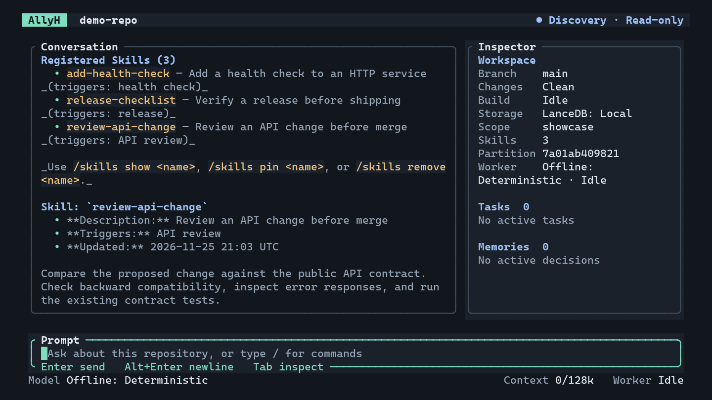

# AllyH

**Coherence-First AI Agent Harness in Rust**

AllyH is a lightweight, out-of-tree operating system around [`rig-core`](https://crates.io/crates/rig-core) and [LanceDB](https://lancedb.com/). It prevents long-running context drift across coding sessions without polluting your repository with static Markdown plans—combining bi-temporal architectural memory, hybrid vector + full-text retrieval, `tree-sitter` dependency ego-graphs, SHA-256 edit integrity checks, prescriptive compiler feedback, and explicit plan approval gates inside a 60 FPS Ratatui terminal interface.

## Screenshots

Captured in an offline demo workspace with sample data.


<details>
<summary>See the skills catalog, skill details, and plan approval</summary>





</details>

---

## Key Capabilities

- **Out-of-Tree LanceDB State:** Stores episodic sessions, architectural invariants, structured task queues, and code graph snapshots outside the target repo—either in the OS-native local data directory (Linux: `~/.local/share/allyh/db`, macOS: `~/Library/Application Support/allyh/db`, Windows: `%LOCALAPPDATA%\allyh\db`) or shared object storage (`s3://`, `gs://`, `az://`) partitioned by `(repo_id, scope_id)`.
- **Bi-Temporal, Conflict-Aware Memory:** New decisions pass through a pre-write hybrid search (`vector` + BM25 FTS) and conflict gate (`ADD`, `UPDATE`, `INVALIDATE`, `NOOP`). Superseded rules are logically invalidated via `invalid_at` / `superseded_by` rather than hard-deleted or left to collide.
- **Interactive Control Gate:** Enforces a strict `Discovery → Plan Approval → Execution` state machine. Write tools remain locked until you explicitly approve a plan (`[Approve Plan]` / `[Refine]`), and tasks cannot transition to `verified` without a passing `cargo` verification proof.
- **Prescriptive ACI Tools:** Compact `rig-core` tools (`inspect_symbol`, `edit_by_hash`, `run_verification`, `get_skill`, `add_skill`) reject stale file reads via SHA-256 verification and automatically append structured `cargo check --message-format=json` diagnostics to every edit.
- **Reusable Procedural Skills (Progressive Disclosure):** Store repo-scoped procedures in LanceDB (`skills` table), inject a lightweight skill catalog into every turn's preamble, expand full instructions automatically when pinned or trigger-matched (or lazily via `get_skill`), and manage or import/export `SKILL.md` files from both the TUI (`/skills`) and CLI (`allyh skills`).
- **Live Environment & RepoGraph Awareness:** Combines `notify` filesystem watching, `git2` status/diffs, SHA-256 out-of-band edit detection, and incremental `tree-sitter-rust` indexing to inject concise diffs and 1-hop/2-hop symbol *ego-graphs* into each turn's preamble.
- **Hybrid Routing & Sleep-Time Compute:** Routes primary reasoning to frontier APIs (Anthropic / OpenAI) or large local models, while delegating non-destructive history compaction, conflict judging, and idle LanceDB fragment optimization to a fast local OpenAI-compatible worker (`llama.cpp` / Ollama) with deterministic offline fallbacks.

---

## Architecture

```text
┌──────────────────────────────────────────────────────────────────────┐
│                      AllyH TUI Loop (Ratatui)                        │
│  [Left 70%: Streamed Chat & Tool Cards] │ [Right 30%: Live Memory]   │
└───────────────▲──────────────────────────────────┬───────────────────┘
                │ UiEvent (Tokens/State/Gates)     │ UserCommand
┌───────────────┴──────────────────────────────────▼───────────────────┐
│                 AllyH Core Orchestrator (rig-core)                   │
│  1. Dynamic Preamble Assembler (EnvDelta + Tasks + Memories + Graph) │
│  2. Control Gate (Discovery -> Plan Approval -> Execution)           │
│  3. Hybrid Router (Frontier API vs. Local OpenAI-Compatible Server)  │
└───▲───────────────────────────┬──────────────────────────────────┬───┘
    │ EnvDelta                  │ TurnCompleted                    │
┌───┴────────────────────┐  ┌───▼──────────────────────────────────▼───┐
│  Environment Monitor   │  │     Memory Consolidator (Async/Idle)     │
│  - notify (FS watcher) │  │  - Local LLM Conflict Gate / Compactor   │
│  - git2 (HEAD/diffs)   │  │  - Bi-Temporal Merge & Invalidation      │
│  - tree-sitter + cargo │  │  - LanceDB (Local Dir or S3/MinIO/GCS)   │
└────────────────────────┘  └──────────────────────────────────────────┘
```

### Workspace Crates

| Crate | Responsibility |
| :--- | :--- |
| `crates/allyh-memory` | LanceDB connection manager (local & object store), Apache Arrow schemas (`sessions`, `architectural_decisions`, `tasks`, `code_graph_snapshots`, `skills`), `SKILL.md` parser/renderer, hybrid vector + BM25 search, bi-temporal consolidator, and read-only sleep-time worker. |
| `crates/allyh-env` | `notify` FS watcher, `git2` tracker, SHA-256 out-of-band edit detector, `tree-sitter-rust` RepoGraph indexer, and `cargo --message-format=json` diagnostics runner. |
| `crates/allyh-tools` | Compact ACI `rig_core::tool::Tool` implementations (`inspect_symbol`, `edit_by_hash`, `run_verification`, `get_skill`, `add_skill`) with write-gate enforcement and post-edit compiler hooks. |
| `crates/allyh-core` | Tokio orchestrator actor, `ControlGate`, `HybridRouter`, `DynamicPreambleAssembler`, non-destructive `CompactingHistory`, and local LLM conflict judge. |
| `crates/allyh-tui` | `allyh` binary: 60 FPS Ratatui split-pane UI, `syntect` Markdown/code highlighting, collapsible Tool Cards, Coherence Inspector sidebar, and interactive gate modals. |

---

## Quick Start

### Install Prebuilt Binary

**Linux / macOS:**

```bash
curl -fsSL https://raw.githubusercontent.com/alexvegadev/allyh/main/scripts/install.sh | sh
```

**Windows (PowerShell):**

```powershell
irm https://raw.githubusercontent.com/alexvegadev/allyh/main/scripts/install.ps1 | iex
```

Both installers automatically detect your platform, verify the `SHA256SUMS` digest from the GitHub Release, and install the `allyh` binary (`~/.local/bin` on Linux/macOS, `%LOCALAPPDATA%\allyh\bin` on Windows). You can override the version or destination with `ALLYH_VERSION` (e.g. `v0.2.0`) and `ALLYH_INSTALL_DIR`.

### Prerequisites (Building from Source)

- Supported platforms: **Linux**, **macOS**, and **Windows**
- Rust toolchain (Edition 2024 / Cargo), `protoc` (Protocol Buffers compiler, required by LanceDB), and a C compiler for bundled `libgit2` / `tree-sitter` crates

### Build & Run

```bash
# Run against the current repository (local LanceDB in your OS local data directory)
cargo run -p allyh-tui -- --repo .

# Connect to a shared S3 / MinIO LanceDB backend with an isolated agent scope
cargo run -p allyh-tui -- \
  --repo /path/to/project \
  --db-uri s3://allyh-memory-bucket/shared-db \
  --scope agent-1 \
  --model anthropic:claude-sonnet-4-6 \
  --worker-model local:qwen2.5-coder-9b@http://localhost:9931/v1
```

### Managing Skills from the CLI

Inspect, author, and import/export reusable procedural skills without launching the TUI (honors `--repo`, `--db-uri`, and `--scope`):

```bash
# List registered skills for the current repository
allyh skills list
allyh skills list --json

# View a skill's full instructions
allyh skills show add-lancedb-table

# Register a skill directly or import/export portable SKILL.md files
allyh skills add release-flow -d "Release checklist" -i "1. Bump Cargo.toml. 2. Run cargo test." -t release
allyh skills import path/to/SKILL.md
allyh skills export release-flow --out release-flow/SKILL.md

# Remove a skill
allyh skills remove release-flow
```

### Self-Update

AllyH supports in-place updates from GitHub Releases via the `update` subcommand:

```bash
# Check whether a newer release is available without installing
allyh update --check

# Download and install the latest release (pass --yes to skip prompts, --tag <TAG> for a specific release)
allyh update
```

Set `GH_TOKEN` / `GITHUB_TOKEN` (or pass `--token`) to avoid unauthenticated GitHub API rate limits or update from a private repository.

### Configuration

#### CLI Options

| Flag | Environment Variable | Default | Description |
| :--- | :--- | :--- | :--- |
| `-r, --repo <PATH>` | — | `.` | Target repository directory |
| `--db-uri <URI>` | `ALLYH_DB_URI` | OS local data dir (`allyh/db`) | Local path (supports `~/` expansion) or `s3://`, `gs://`, `az://` LanceDB URI |
| `--scope <SCOPE>` | `ALLYH_SCOPE_ID` | `default` | Multi-agent or team memory partition scope |
| `--model <SPEC>` | `ALLYH_MODEL` | Auto-detected | Primary model (`anthropic:<id>`, `openai:<id>`, `local:<id>[@url]`, `offline`) |
| `--worker-model <SPEC>` | `ALLYH_WORKER_MODEL` | Auto-detected | Local background worker model for compaction & consolidation |
| `--embedding-model <SPEC>` | `ALLYH_EMBEDDING_MODEL` | Auto-detected | Embedding model (`local:<id>[@url]`, `ollama:<id>[@url]`, `voyage:<id>`, `jina:<id>`, `gemini:<id>`, `openai:<id>`, `offline`) |
| `--no-auto-check` | — | `false` | Disable automatic post-edit `cargo check` |

#### Provider Environment Variables

- **Anthropic:** `ANTHROPIC_API_KEY` (optional `ANTHROPIC_BASE_URL`)
- **OpenAI:** `OPENAI_API_KEY` (optional `OPENAI_BASE_URL`)
- **Local OpenAI-compatible server (`llama.cpp` / Ollama):** `ALLYH_LOCAL_BASE_URL` or `LLAMACPP_API_BASE_URL` (defaults to `http://localhost:9931/v1`), `ALLYH_LOCAL_MODEL`, optional `LLAMACPP_API_KEY`, optional `OLLAMA_HOST` (defaults to `http://localhost:11434/v1` for `ollama:` specs)
- **Embeddings (optional; auto-falls back to deterministic offline hashing):** `ALLYH_EMBEDDING_MODEL`, `ALLYH_EMBEDDING_BASE_URL`, `ALLYH_EMBEDDING_API_KEY`, or provider keys `VOYAGE_API_KEY`, `JINA_API_KEY`, `GEMINI_API_KEY` / `GOOGLE_API_KEY`, `OPENAI_API_KEY`. Vectors wider than 384 dims are Matryoshka (MRL) prefix-truncated and L2-normalized automatically.
  - Recommended local specs: `local:Qwen3-Embedding-0.6B`, `ollama:nomic-embed-text`, or `local:bge-small-en-v1.5`
  - Recommended free-tier API specs: `voyage:voyage-code-3`, `jina:jina-embeddings-v3`, or `gemini:gemini-embedding-001`

When no API keys or local servers are configured, AllyH runs cleanly in deterministic offline mode so you can inspect the TUI, LanceDB state, and workflow locally.

---

## TUI Commands & Keybindings

### Slash Commands

| Command | Action |
| :--- | :--- |
| `/plan <goal>` | Open the interactive Plan Approval Gate modal (`[Approve Plan]` / `[Refine]`) |
| `/model <spec>` | Switch the active reasoning model at runtime |
| `/memories` | List active architectural invariants from LanceDB (`invalid_at IS NULL`) |
| `/skills` | List registered skills (`show <name>`, `pin <name>`, `import <path>`, `remove <name>`) |
| `/pin <id-prefix>` | Pin or unpin an invariant so it is always injected into the preamble |
| `/invalidate <id-prefix>` | Logically invalidate a stale rule (`invalid_at = NOW()`) |
| `/db-status` | Show active LanceDB URI, backend type, partition IDs, and table row counts |
| `/compact` | Run non-destructive history compaction immediately |
| `/refresh` | Re-scan workspace SHA-256 hashes and run `cargo check` |
| `/help` | Show commands and shortcuts |
| `/quit` | Gracefully shut down background workers and exit |

### Keybindings

- **Prompt input:** `Enter` send · `Alt+Enter` / `Shift+Enter` / `Ctrl+J` newline
- **Global:** `Tab` cycle focus (Input → Memories → Chat) · `Ctrl+T` or `F2` expand/collapse ACI Tool Cards · `Ctrl+C` quit
- **Activated Memories sidebar:** `↑`/`↓` (`k`/`j`) select · `p` pin/unpin · `x` logically invalidate
- **Plan Approval modal:** `A` / `Enter` approve plan & unlock writes · `R` / `Esc` refine & remain read-only

---

## Testing

Run the full workspace test suite, including the **5-Step Isolation & Coherence Acceptance Suite** (`crates/allyh-core/tests/acceptance_suite.rs`):

```bash
cargo test --workspace
```

The acceptance suite verifies:
1. Establishing an architectural constraint in Session A without writing `.md` plan files to the repository.
2. Reopening in Session B and automatically injecting the persisted invariant from LanceDB.
3. Detecting an out-of-band manual file edit via SHA-256 mismatch, incrementally re-indexing with `tree-sitter`, and injecting the diff summary.
4. Overriding the invariant in Session C so the old rule is logically superseded (`invalid_at` + `superseded_by`) without retrieval conflict.
5. Strict `(repo_id, scope_id)` partition isolation across separate repositories and agent scopes sharing the same LanceDB URI.

---

## License

MIT
