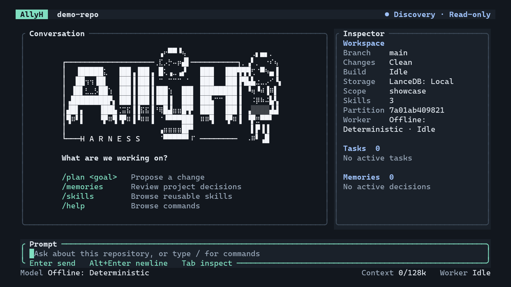
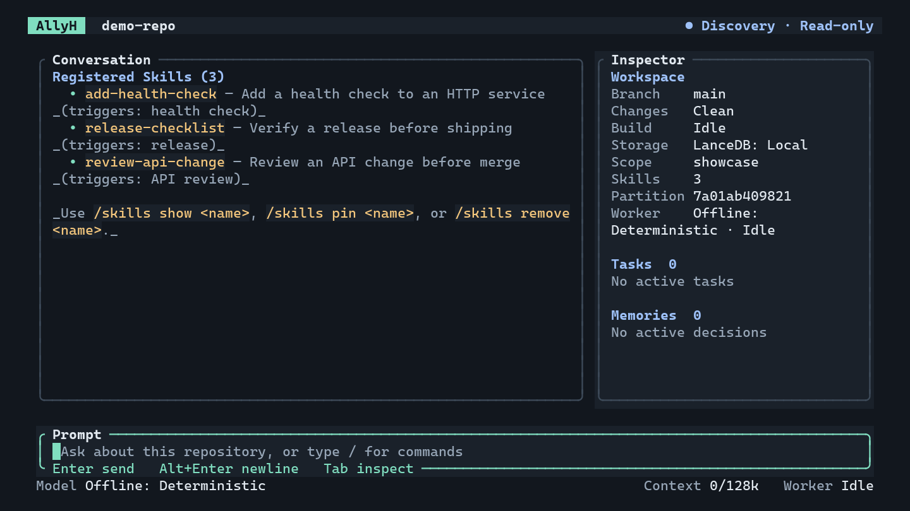
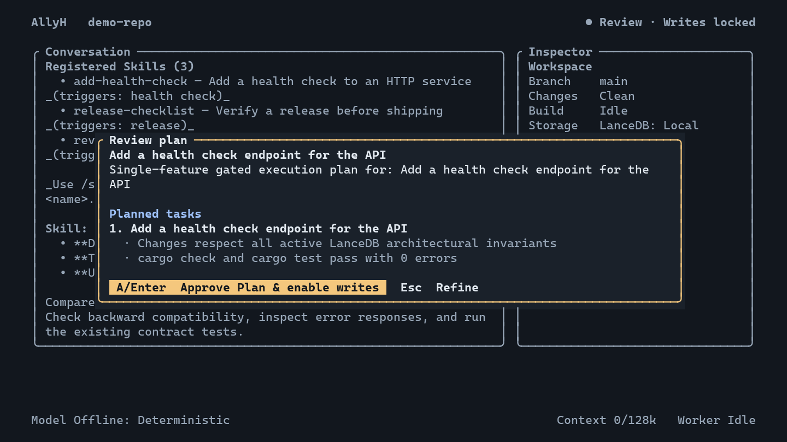

# AllyH

**Coherence-First Polyglot AI Agent Harness in Rust**

AllyH is a lightweight, out-of-tree operating system around [`rig-core`](https://crates.io/crates/rig-core) and [LanceDB](https://lancedb.com/). It prevents long-running context drift across coding sessions without polluting your repository with static Markdown plans or dotfiles—combining polyglot `tree-sitter` + LSP dependency *ego-graphs*, bi-temporal architectural memory, hybrid vector + full-text retrieval, SHA-256 edit integrity checks, prescriptive multi-language verification, dual-mode MCP (Client & Server), cache-aware prompt partitioning, multi-objective Self-Improvement Memory (SIM/CRSI), headless CI auditing, and isolated multi-agent Git worktrees inside a 60 FPS Ratatui terminal interface.

## Screenshots

Captured in an offline demo workspace with sample data.



<details>
<summary>See the skills catalog, skill details, and plan approval</summary>






</details>

---

## Key Capabilities

- **Out-of-Tree LanceDB State:** Stores episodic sessions (with token, cache-hit, and USD cost telemetry), architectural invariants, structured task queues, code graph snapshots, skills, per-repository profiles (`repo_profiles`), and SIM ledgers outside the target repo—either in the OS-native local data directory (Linux: `~/.local/share/allyh/db`, macOS: `~/Library/Application Support/allyh/db`, Windows: `%LOCALAPPDATA%\allyh\db`) or shared object storage (`s3://`, `gs://`, `az://`) partitioned by `(repo_id, scope_id)`.
- **Polyglot Language & Toolchain Engine:** First-class `tree-sitter` RepoGraph indexing for **Rust, TypeScript/TSX, JavaScript/JSX, Python, and Go** (feature-gated in `allyh-env`), `.gitignore`-aware discovery, and automatic monorepo verification routing across `cargo`, `tsc` / `eslint` / `biome` / `npm` / `pnpm` / `yarn` / `bun`, `pytest` / `ruff` / `mypy` / `pyright`, `go test` / `go vet` / `golangci-lint`, and custom SARIF / `file:line` commands configured out-of-tree via `allyh config` or `/config`.
- **Zero-Config LSP Semantic Bridge:** Auto-discovers installed language servers on `PATH` (`rust-analyzer`, `vtsls` / `typescript-language-server`, `pyright` / `basedpyright` / `pylsp`, `gopls`, `clangd`) over stdio JSON-RPC 2.0 to disambiguate RepoGraph call/reference edges and return sub-second post-edit diagnostics via `textDocument/didChange` (with seamless fallback to `tree-sitter` + CLI verifiers when no LSP is installed).
- **Bi-Temporal, Conflict-Aware Memory:** New decisions pass through a pre-write hybrid search (`vector` + BM25 FTS) and conflict gate (`ADD`, `UPDATE`, `INVALIDATE`, `NOOP`). Superseded rules are logically invalidated via `invalid_at` / `superseded_by` rather than hard-deleted—inspectable chronologically via `/timeline` or `allyh memory timeline`.
- **Interactive Control Gate, Command Approval & Atomic Checkpoints:** Enforces a strict `Discovery → Plan Approval → Execution` state machine. Write tools and mutating external MCP tools remain locked until plan approval, `run_command` routes non-read-only commands through a policy gate with an interactive **Command Approval Modal** (`Allow Once` / `Allow Pattern` / `Deny`), and approving a plan automatically captures an out-of-tree `PlanCheckpoint` for instant `/diff` inspection and one-command `/rollback`.
- **Compact Prescriptive ACI Tools:** Built-in `rig-core` tools—`inspect_symbol`, `edit_by_hash` (single-hunk and atomic multi-hunk with rollback on partial mismatch), `run_verification` (with optional `test_filter`), `search_code` (hybrid regex/literal + semantic LanceDB ranking), `git_inspect` (`status`/`log`/`diff`/`blame`), `run_command`, `get_skill`, `add_skill`, and `inspect_sim`—reject stale file edits via SHA-256 verification and automatically attach structured compiler/LSP diagnostics.
- **Dual-Mode MCP (Client & Server):**
  - **MCP Client:** Connects to external `stdio` and Streamable HTTP / `text/event-stream` SSE MCP servers (configured out-of-tree in LanceDB or via `--mcp-server`), mounts tools as `mcp__<server>__<tool>`, renders them as collapsible Tool Cards, and enforces AllyH's `ControlGate` conservatively on every tool not explicitly annotated `readOnlyHint: true` (and `destructiveHint != true`).
  - **MCP Server (`allyh mcp serve`):** Exposes AllyH's bi-temporal memory, polyglot RepoGraph, skills, tasks, and SIM ledger over stdio JSON-RPC 2.0 (12 annotated tools) to external editors and agents (VS Code, Cursor, Claude Code, Antigravity, Zed) with full `(repo_id, scope_id)` isolation and conflict-gated writes.
- **Expanded Providers, Prompt Caching & Cost Telemetry:** Native routing across **Anthropic**, **OpenAI** (Chat & Responses API), **Google Gemini**, **OpenRouter**, local OpenAI-compatible servers (`llama.cpp` / Ollama), deterministic offline mode, and optional feature-gated enterprise gateways (**AWS Bedrock** / **Google Vertex AI**), with `--reasoning-effort low|medium|high`. `DynamicPreambleAssembler` partitions every turn into a **byte-invariant `stable_prefix`** (pinned invariants, operating rules, sorted skills catalog + SHA-256 cache routing key) and a **`volatile_suffix`** (`EnvDelta`, tasks, ego-graphs) to maximize prompt-cache hits, while tracking input/output/cached tokens and estimated USD cost in LanceDB and the TUI status bar.
- **Cost-Aware SIM & Continual RSI:** Implements Google Cloud AI / Google DeepMind's **SIM** framework ([arXiv:2611.18856](https://arxiv.org/abs/2611.18856)) with a **multi-objective Selector** (pass rate + token budget + tool-round + latency efficiency, strictly blocking pass-rate regressions), ready-to-run **polyglot benchmark presets** (`rust`, `typescript`, `python`, `go`, `polyglot`), and **live session trace harvesting** (`allyh sim harvest`) that distills real failed/recovered interactive sessions into deduplicated `P1..Pn` diagnoses.
- **Headless CI & Multi-Agent Git Worktrees:** Run AllyH non-interactively in CI (`allyh run --output jsonl`, `--mode discovery-only` or `--mode execute --auto-approve`), enforce architectural invariants on PR diffs (`allyh audit --base main`, exiting non-zero on breach), isolate parallel agents in out-of-tree `git worktree`s (`allyh worktree create`) sharing one LanceDB `repo_id` with cross-scope file-overlap warnings in `EnvDelta`, and promote verified decisions/skills across scopes through the conflict gate (`allyh memory promote --from <scope> --to team`).
- **TUI Coherence Upgrades:** 60 FPS Ratatui interface featuring an **Interactive Diff Modal** (unified `syntect` & toggleable side-by-side view), **Bi-Temporal Timeline (`/timeline`)**, **Session Browser & Resume (`/sessions`)**, mouse-wheel scrolling across panes/modals, and one-key OSC 52 terminal clipboard copy (`Ctrl+Y` / `Y`).

---

## Architecture

```text
┌───────────────────────────────────────────────────────────────────────────┐
│                      AllyH TUI / CLI / MCP Server                         │
│  [Left: Streamed Chat, Tool Cards, Diff/Plan/Cmd Modals] │ [Inspector]    │
│  CLI: run · audit · mcp · memory · worktree · config · lsp · skills · sim │
└───────────────────▲──────────────────────────────────┬────────────────────┘
                    │ UiEvent (Tokens/State/Gates)     │ UserCommand
┌───────────────────┴──────────────────────────────────▼────────────────────┐
│                    AllyH Core Orchestrator (rig-core)                     │
│  1. Cache-Aware Preamble (Byte-Stable Prefix + Volatile Suffix + Key)     │
│  2. Control Gate (Discovery -> Plan Approval + Checkpoint -> Execution)   │
│  3. Hybrid Router (Anthropic / OpenAI Responses / Gemini / OpenRouter /   │
│     Local Worker / Optional Bedrock & Vertex) + Token/Cache/USD Telemetry │
│  4. ACI Toolset + CommandPolicyGate + MCP Client Manager (Stdio/HTTP/SSE) │
└───▲─────────────────────────────┬─────────────────────────────────────┬───┘
    │ EnvDelta + Cross-Scope      │ TurnCompleted                       │
┌───┴──────────────────────┐  ┌───▼─────────────────────────────────────▼───┐
│   Environment Monitor    │  │       Memory Consolidator (Async/Idle)      │
│  - notify + git2/worktree│  │  - Local LLM Conflict Gate / Compactor      │
│  - Polyglot tree-sitter  │  │  - Bi-Temporal Merge, Invalidation & Promote│
│  - LSP Semantic Bridge   │  │  - LanceDB (Local Dir or S3/MinIO/GCS/Az)   │
│  - Multi-Lang Verifiers  │  └─────────────────────────────────────────────┘
└──────────────────────────┘
```

### Workspace Crates

| Crate | Responsibility |
| :--- | :--- |
| `crates/allyh-memory` | LanceDB connection manager (local & object store), Apache Arrow schemas + automatic column migrations (`sessions`, `architectural_decisions`, `tasks`, `code_graph_snapshots`, `skills`, `repo_profiles`, `harness_versions`, `sim_runs`, `sim_problems`, `sim_attempts`), `SKILL.md` & Appendix D.3 SIM JSON codecs, hybrid vector + BM25 search, cross-scope snapshot queries, bi-temporal consolidator + `promote_scope`, and read-only sleep-time worker. |
| `crates/allyh-env` | `notify` FS watcher, `git2` tracker (`status`, `log`, `diff`, `diff_against_base`, `blame`), `WorktreeManager`, out-of-tree `PlanCheckpoint` + rollback, SHA-256 out-of-band edit & cross-scope overlap detector, polyglot `tree-sitter` RepoGraph indexers (Rust/TS/JS/Python/Go), stdio JSON-RPC 2.0 LSP bridge (`LspClient`/`LspManager`), hybrid code search, and pluggable multi-language toolchain verifiers. |
| `crates/allyh-tools` | Compact ACI `rig_core::tool::Tool` implementations (`inspect_symbol`, atomic multi-hunk `edit_by_hash`, `run_verification`, `search_code`, `git_inspect`, `run_command` with `CommandPolicyGate`, `get_skill`, `add_skill`, `inspect_sim`) plus `McpClientManager` (stdio & Streamable HTTP/SSE with Control Gate enforcement). |
| `crates/allyh-core` | Tokio orchestrator actor, `AllyHMcpServer` (12-tool stdio MCP server), headless CI runner & PR drift auditor (`audit.rs`), `HarnessSpec`, `CompletionInterlock`, `ControlGate`, `HybridRouter` + `ModelPricing` / `SessionTelemetry`, cache-aware `DynamicPreambleAssembler`, non-destructive `CompactingHistory`, and local LLM conflict judge. |
| `crates/allyh-sim` | Continual Recursive Self-Improvement (CRSI) engine: disjoint `EvolveSplit` / `HeldOutSplit` isolation, SIM-conditioned Proposer & multi-objective two-stage Selector (`ColdStart`, `HarnessTransfer`, `ProblemOnly`, `FullSim`), polyglot benchmark suite presets (`presets.rs`), live session trace harvester (`harvest.rs`), `AllyHRuntimeEvaluator`, `CommandHarnessEvaluator`, and `UnifiedMultiModelEvaluator`. |
| `crates/allyh-tui` | `allyh` binary: 60 FPS Ratatui split-pane UI with mouse scrolling, `syntect` Markdown & Interactive Diff Modal (unified/side-by-side), copy-friendly collapsible Tool Cards (OSC 52), Coherence Inspector sidebar, Plan & Command Approval modals, and all CLI subcommands. |

---

## Quick Start

### Install Prebuilt Binary

**Linux / macOS:**

```bash
curl -fsSL https://raw.githubusercontent.com/alexvegadev/allyh/main/scripts/install.sh | sh
```

**Windows (PowerShell):**

```powershell
irm https://raw.githubusercontent.com/alexvegadev/allyh/main/scripts/install.ps1 | iex
```

Both installers automatically detect your platform, verify the `SHA256SUMS` digest from the GitHub Release, and install the `allyh` binary (`~/.local/bin` on Linux/macOS, `%LOCALAPPDATA%\allyh\bin` on Windows). You can override the version or destination with `ALLYH_VERSION` and `ALLYH_INSTALL_DIR`.

### Prerequisites (Building from Source)

- Supported platforms: **Linux**, **macOS**, and **Windows**
- Rust toolchain (Edition 2024 / Cargo), `protoc` (Protocol Buffers compiler, required by LanceDB), and a C compiler for bundled `libgit2` / `tree-sitter` crates
- Optional enterprise providers: build with `--features allyh-core/enterprise-providers` (or `bedrock`, `vertex`)

### Build & Launch TUI

```bash
# Run against the current repository (local LanceDB in your OS local data directory)
cargo run -p allyh-tui -- --repo .

# Connect to a shared S3 / MinIO LanceDB backend with Gemini, reasoning effort, and an MCP server
cargo run -p allyh-tui -- \
  --repo /path/to/project \
  --db-uri s3://allyh-memory-bucket/shared-db \
  --scope agent-1 \
  --model gemini:gemini-2.5-pro \
  --reasoning-effort high \
  --worker-model local:qwen2.5-coder-9b@http://localhost:9931/v1 \
  --mcp-server docs=https://mcp.example.com/rpc
```

---

## CLI Reference

All maintenance and automation subcommands honor global `--repo`, `--db-uri`, and `--scope` flags.

### Polyglot Configuration & LSP Bridge

```bash
# Inspect detected languages, toolchains, and out-of-tree LanceDB overrides
allyh config show
allyh config show --json

# Persist custom check/lint/test commands or extra ignore globs without writing dotfiles
allyh config set --check "npx tsc --noEmit" --test "pytest -q" --ignore "generated/**"
allyh config reset

# Inspect auto-discovered LSP servers on PATH for this workspace
allyh lsp status --json
```

### Dual-Mode MCP (Client & Server)

```bash
# Run AllyH itself as a stdio JSON-RPC 2.0 MCP server for Cursor, Claude Code, VS Code, Zed, or Antigravity
allyh mcp serve --repo . --scope default

# Register external MCP servers in out-of-tree LanceDB (stdio or Streamable HTTP/SSE)
allyh mcp add github --url https://api.githubcopilot.com/mcp/ --header "Authorization: Bearer $TOKEN"
allyh mcp add filesystem --command npx --arg -y --arg @modelcontextprotocol/server-filesystem --arg .
allyh mcp status --json
allyh mcp remove github
```

### Headless CI Execution & PR Architectural Drift Audit

```bash
# Read-only CI review streaming structured JSONL tool records, replies, and telemetry
allyh run "Audit error handling in crates/allyh-core" --mode discovery-only --output jsonl

# Headless CI autofix with auto-approval and mandatory passing VerificationProof
allyh run --task-file task.md --mode execute --auto-approve --output jsonl

# Check PR diff against active bi-temporal LanceDB invariants (exits non-zero on violation)
allyh audit --base main
allyh audit --base origin/main --json
```

### Multi-Agent Git Worktrees & Bi-Temporal Memory Promotion

```bash
# Spawn an isolated out-of-tree Git worktree bound to an agent scope sharing the same LanceDB repo_id
allyh worktree create task-auth --base main
allyh worktree list
allyh worktree remove task-auth

# Promote verified architectural decisions and skills from an agent scope into a shared team scope
# (every decision passes through the bi-temporal conflict gate)
allyh memory promote --from task-auth --to team
allyh memory timeline --json
```

### Reusable Procedural Skills

```bash
allyh skills list [--json]
allyh skills show add-lancedb-table
allyh skills add release-flow -d "Release checklist" -i "1. Bump Cargo.toml. 2. Run cargo test." -t release
allyh skills import path/to/SKILL.md
allyh skills export release-flow --out release-flow/SKILL.md
allyh skills remove release-flow
```

### Self-Improvement Memory (SIM) & Cost-Aware CRSI

```bash
# Inspect active harness version, SIM lineage, and recurring problem entries
allyh sim status
allyh sim list
allyh sim show P1

# Generate or run built-in polyglot benchmark presets (rust, typescript, python, go, polyglot)
allyh sim preset typescript --out ts-suite.json
allyh sim evolve --preset polyglot --rounds 5 --candidates 5 --mode full-sim

# Harvest real failed/recovered interactive sessions and task traces into SIM diagnoses (P1..Pn)
allyh sim harvest
allyh sim harvest --json

# Export/import canonical arXiv:2611.18856 Appendix D.3 SIM JSON ledgers
allyh sim export --out sim-ledger.json
allyh sim import sim-ledger.json --arm carried-sim

# Continue CRSI across a new benchmark or model carrying (H_S, M_S) and evaluate on held-out split
allyh sim continue --from-run source-rsi --suite bench_target.json --model openai:gpt-5.2 --mode full-sim
allyh sim eval --harness active --suite bench_target.json --split held-out --rollouts 5
allyh sim use <version-id-or-label>
```

### Self-Update

```bash
allyh update --check
allyh update [--yes] [--tag <TAG>]
```

Set `GH_TOKEN` / `GITHUB_TOKEN` (or pass `--token`) to avoid unauthenticated GitHub API rate limits or update from a private repository.

---

## Configuration

### CLI Options

| Flag | Environment Variable | Default | Description |
| :--- | :--- | :--- | :--- |
| `-r, --repo <PATH>` | — | `.` | Target repository directory |
| `--db-uri <URI>` | `ALLYH_DB_URI` | OS local data dir (`allyh/db`) | Local path (supports `~/` expansion) or `s3://`, `gs://`, `az://` LanceDB URI |
| `--scope <SCOPE>` | `ALLYH_SCOPE_ID` | `default` | Multi-agent or team memory partition scope |
| `--model <SPEC>` | `ALLYH_MODEL` | Auto-detected | Primary model (`anthropic:<id>`, `openai:<id>`, `openai-responses:<id>`, `gemini:<id>`, `openrouter:<org/id>`, `local:<id>[@url]`, `offline`, or feature-gated `bedrock:<id>` / `vertex:<id>`) |
| `--reasoning-effort <LEVEL>` | `ALLYH_REASONING_EFFORT` | Unset | Reasoning effort for reasoning-capable models (`low`, `medium`, `high`) |
| `--worker-model <SPEC>` | `ALLYH_WORKER_MODEL` | Auto-detected | Local background worker model for compaction & consolidation |
| `--embedding-model <SPEC>` | `ALLYH_EMBEDDING_MODEL` | Auto-detected | Embedding model (`local:<id>[@url]`, `ollama:<id>[@url]`, `voyage:<id>`, `jina:<id>`, `gemini:<id>`, `openai:<id>`, `offline`) |
| `--mcp-server <NAME=SPEC>` | — | None | Attach external MCP server(s) for this session (repeatable) |
| `--no-auto-check` | — | `false` | Disable automatic post-edit project verification |

### Provider Environment Variables

- **Anthropic:** `ANTHROPIC_API_KEY` (optional `ANTHROPIC_BASE_URL`)
- **OpenAI (Chat & Responses API):** `OPENAI_API_KEY` (optional `OPENAI_BASE_URL`; GPT-5 / o-series / `--reasoning-effort` automatically route through OpenAI Responses API)
- **Google Gemini:** `GEMINI_API_KEY` (optional `GEMINI_BASE_URL`)
- **OpenRouter:** `OPENROUTER_API_KEY` (optional `OPENROUTER_BASE_URL`)
- **Enterprise Gateways (feature-gated):**
  - AWS Bedrock (`--features bedrock`): `AWS_BEARER_TOKEN_BEDROCK` / `AWS_BEDROCK_API_KEY`, `AWS_REGION`, optional `AWS_BEDROCK_BASE_URL`
  - Google Vertex AI (`--features vertex`): `VERTEX_AI_ACCESS_TOKEN` / `GEMINI_API_KEY`, `GOOGLE_CLOUD_LOCATION`, optional `VERTEX_AI_BASE_URL`
- **Local OpenAI-compatible server (`llama.cpp` / Ollama):** `ALLYH_LOCAL_BASE_URL` or `LLAMACPP_API_BASE_URL` (defaults to `http://localhost:9931/v1`), `ALLYH_LOCAL_MODEL`, optional `LLAMACPP_API_KEY`, optional `OLLAMA_HOST` (defaults to `http://localhost:11434/v1` for `ollama:` specs)
- **Embeddings (optional; falls back to deterministic offline hashing):** `ALLYH_EMBEDDING_MODEL`, `ALLYH_EMBEDDING_BASE_URL`, `ALLYH_EMBEDDING_API_KEY`, or `VOYAGE_API_KEY`, `JINA_API_KEY`, `GEMINI_API_KEY` / `GOOGLE_API_KEY`, `OPENAI_API_KEY`. Vectors wider than 384 dims are Matryoshka (MRL) prefix-truncated and L2-normalized automatically.

When no API keys or local servers are configured, AllyH runs cleanly in deterministic offline mode so you can inspect the TUI, LanceDB state, MCP server, and workflows locally.

---

## TUI Commands & Keybindings

### Slash Commands

| Command | Action |
| :--- | :--- |
| `/plan <goal>` | Open the interactive Plan Approval Gate modal (captures an automatic pre-execution checkpoint on approval) |
| `/diff` | Open the Interactive Diff Viewer modal (unified `syntect` & toggleable side-by-side view) |
| `/rollback` | Restore modified files and remove newly created files back to the pre-plan checkpoint |
| `/model <spec>` | Show or switch the active reasoning model at runtime |
| `/memories` | List active architectural invariants from LanceDB (`invalid_at IS NULL`) |
| `/timeline` | Browse full bi-temporal history of active and superseded decisions (`superseded_by` chains & rationales) |
| `/sessions [resume <id>]` | Browse prior sessions (timestamps, cache %, USD cost, summaries) or resume a previous session's rolling context |
| `/skills [cmd]` | List, show, pin, import (`SKILL.md`), or remove reusable skills |
| `/sim [cmd]` | Inspect active harness & SIM ledger (`list`, `show <P-id>`, `harness`, `use <id>`, `export [path]`) |
| `/config [cmd]` | Show detected polyglot stack or override check/lint/test commands in out-of-tree LanceDB |
| `/lsp [status\|restart]` | Inspect discovered/running LSP servers or restart a language server |
| `/mcp [status\|add\|remove]` | Inspect, connect, or remove external MCP servers at runtime |
| `/pin <id-prefix>` | Pin or unpin an invariant in the cache-stable preamble prefix |
| `/invalidate <id-prefix>` | Logically invalidate a stale rule (`invalid_at = NOW()`) |
| `/db-status` | Show active LanceDB URI, backend type, partition IDs, and table row counts |
| `/compact` | Run non-destructive history compaction immediately |
| `/refresh` | Re-scan workspace SHA-256 hashes, cross-scope overlaps, and run project verification |
| `/help` | Show commands and shortcuts |
| `/quit` | Gracefully shut down MCP servers, LSP processes, and background workers, then exit |

### Keybindings & Mouse Controls

- **Prompt input:** `Enter` send · `Alt+Enter` / `Shift+Enter` / `Ctrl+J` newline
- **Global:** `Tab` / `Shift+Tab` cycle focus (Input → Memories → Chat) · `Ctrl+T` or `F2` expand/collapse Tool Cards · `Ctrl+Y` copy latest diff / expanded Tool Card / code block to clipboard (OSC 52) · `Mouse Wheel` scroll active pane or modal · `Ctrl+C` quit
- **Chat pane:** `↑`/`↓` / `PgUp`/`PgDn` / `Home`/`End` scroll · `Y` copy latest snippet
- **Activated Memories sidebar:** `↑`/`↓` (`k`/`j`) select · `p` pin/unpin · `x` logically invalidate
- **Plan Approval modal:** `A` / `Enter` approve plan, capture checkpoint & unlock writes · `R` / `Esc` refine & remain read-only
- **Command Approval modal:** `A` / `Enter` allow once · `P` allow command pattern for session · `D` / `Esc` deny
- **Interactive Diff modal:** `S` toggle Unified / Side-by-Side · `Y` copy diff · `↑`/`↓`/`PgUp`/`PgDn`/Mouse Wheel scroll · `Esc` / `Q` close

---

## Testing

Run the full workspace test suite (**78 tests** across all 6 crates):

```bash
cargo test --workspace

# Optional: verify enterprise provider feature flags (Bedrock + Vertex AI)
cargo check -p allyh-core --features enterprise-providers
```

Key end-to-end suites included in the workspace:

- **Core Isolation, Polyglot, Checkpoints, CI Audit & Multi-Agent Worktrees** (`crates/allyh-core/tests/acceptance_suite.rs`): 5-step bi-temporal coherence & isolation suite, polyglot monorepo verification, atomic plan checkpoint diff/rollback, headless CI `audit` + `run` JSONL streaming, and multi-scope shared-LanceDB `git worktree` isolation + cross-scope warnings + conflict-gated decision promotion.
- **Dual-Mode MCP Client ↔ Server Round-Trip** (`crates/allyh-core/tests/mcp_roundtrip.rs`): Real stdio `AllyHMcpServer` subprocess ↔ `McpClientManager` ↔ `AciToolset` (all 12 tools, Control Gate enforcement, polyglot `get_ego_graph`, bi-temporal superseding, skills/tasks) plus Streamable HTTP / SSE transport.
- **Polyglot Indexing, LSP Bridge & Edit Integration** (`crates/allyh-env/tests/env_integration.rs`, `crates/allyh-env/tests/lsp_integration.rs`, `crates/allyh-tools/tests/lsp_edit_integration.rs`, `crates/allyh-tools/tests/tools_integration.rs`): Tree-sitter indexers, diagnostic parsers, `.gitignore` discovery, hybrid LSP disambiguation, instant post-edit LSP diagnostics, atomic multi-hunk `edit_by_hash`, hybrid `search_code`, `git_inspect`, and `CommandPolicyGate`.
- **Prompt Caching, Pricing, SIM & CRSI** (`crates/allyh-core/src/preamble.rs`, `crates/allyh-core/src/router.rs`, `crates/allyh-sim/src/selector.rs`, `crates/allyh-sim/tests/sim_acceptance_suite.rs`): Stable-prefix byte invariance across `EnvDelta` changes, `CacheCost` / USD telemetry, 5-step SIM/CRSI transfer suite, multi-objective selector regression tests, polyglot benchmark presets, and idempotent session trace harvesting.
- **CLI & TUI Rendering** (`crates/allyh-tui/src/cli.rs`, `crates/allyh-tui/src/main.rs`): All CLI subcommands, Ratatui layout & modal tests (Plan Approval, Command Approval, Unified/Side-by-Side Diff Viewer, `/timeline`, `/sessions`, `/mcp`, `/lsp`, `/config`, cache/cost status bar, mouse wheel, and clipboard copy).

---

## Roadmap

See [ROADMAP.md](ROADMAP.md) for the full milestone breakdown and implementation checklist (Milestones 1–6 complete).

---

## License

MIT
